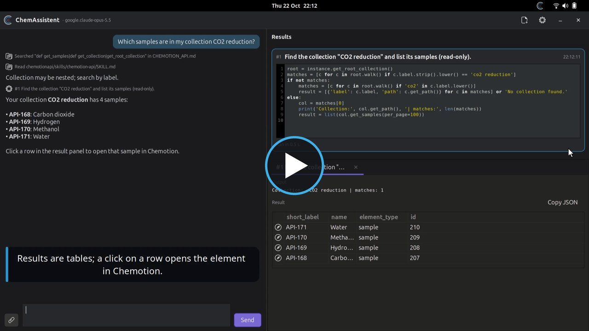

# ChemAssistent

A small desktop app for Ubuntu (and Windows, see
[Install on Windows](#install-on-windows)) that puts a **Chemotion** icon in
the top bar (the tray on Windows) and
lets you talk to your [Chemotion ELN](https://chemotion.net) through an AI
agent. The agent is part of the app (`agent.py`) and talks to any
OpenAI-compatible API, by default the
[KIT KI-Toolbox](https://ki-toolbox.scc.kit.edu), or to a local
[Ollama](https://ollama.com). Instead, the settings can hand the conversation
to [Claude Code](https://claude.com/claude-code) or
[Codex](https://github.com/openai/codex), with the same tools and the same
confirmation (see [Agents](#agents)). It uses the Python package
[chemotion_api](https://github.com/Chemotion/chemotionapi) (a release
tag of your choice, e.g. `v312.0.1`) and knows its API from the package documentation and skills.

**Nothing runs against Chemotion without your confirmation**: every piece of
code the agent wants to run is shown to you first, you can edit it, and it runs
only after you click **Run**. If long tasks keep stopping at the Run button,
turn on an auto-run mode (settings → *Running code*, or the menu in the
conversation header): **Auto-run read-only code** starts snippets that only
fetch data by themselves and still asks for anything that writes or deletes,
**Auto-run everything** runs all code as it arrives. The card still shows what
ran, and you can stop a run while it executes.

[](docs/assets/screencast.mp4)

*Screencast (1:40): from the top-bar icon to a question, the code to confirm,
the result table and a follow-up that adds a sample. Click the picture to
play it. It is recorded from the real app by `docs/screencast.py`.*

## How it works

1. Press **Ctrl+Space twice** quickly, or click the Chemotion icon in the
   top bar and choose **Ask Chemotion…** (a middle click on the icon opens it
   directly). A prompt opens in the middle of the screen.
2. Type what you want, e.g. “Which samples are in my collection Main Test?”,
   and press Enter.
3. The window grows to the full screen:
   - **left**: the chat with the agent. Ask follow-up questions (Enter sends,
     Shift+Enter starts a new line); **Stop** or Esc interrupts the agent.
     Short notes show what it read in the documentation. The paperclip button
     (or dropping files on the chat) attaches files or folders to your next
     message: the agent may read them and use them in its code, e.g. to
     upload a measurement file to a sample;
   - **right**: the results. Each time the agent wants to call the Chemotion
     API, a new tab opens with its purpose and the Python code. **Run** executes
     it (Ctrl+Enter in the code also works), **Reject** refuses it; the optional
     reason is sent to the agent. You can edit the code before running it; the
     agent is told what actually ran. The dot in the tab shows whether the code
     waits for you, runs, ran or failed.
4. The output appears in the same tab below the code (the latest ten tabs are
   kept; code that waits or runs is never dropped): tables for lists and dicts,
   text otherwise, the error traceback when it fails. The first tab, **Links**,
   collects every link the conversation showed: Chemotion elements, the
   JupyterLab notebooks (also of background jobs) and files in the exchange
   folder. Chemotion elements (samples, reactions, …) are rows you can click to
   open the element in the browser. “Copy JSON” copies the result.

The header buttons start a new conversation, open the settings, minimize the
window (the top-bar icon brings it back) or end the conversation. The model
name next to the title is a menu: switch the model for this conversation,
e.g. when the configured one fails; an error in the chat offers **Retry**
(the same request again, possibly with the new model) and **Change model…**.

Conversations are saved after every answer in
`~/.local/state/chem-assistent/history/` (the newest 200). The prompt lists
the latest ones: click one to continue it (the chat comes back, the result
tabs of earlier runs do not), the bin icon deletes it. **Clear history** in
the settings deletes them all. You can also ask the assistant about earlier
conversations (“which sample did I create yesterday?”): it may then search
and read these files, but not on its own. What it reads goes to the AI
model like everything else in the conversation.

## Analyses in JupyterLab

With a JupyterLab configured (settings → *JupyterLab*), the agent gets a
second code tool, `execute_jupyter`, for what Chemotion cannot do: RDKit,
pandas, plots, spectra. Its code appears on the same cards (marked
*JupyterLab*) and runs in your JupyterLab after you click **Run**.

- Every conversation has its own folder there,
  `ChemAssistent/<conversation>/`, with the notebook `analysis.ipynb`. The
  agent's code runs in that notebook's kernel (variables persist between
  steps) and each snippet is appended as a cell with its outputs: open the
  notebook from the result tab (**Open the notebook in JupyterLab**) to look
  at it or continue by hand.
- Data moves through an **exchange folder**: `exchange` in the code of both
  tools. Chemotion code saves samples, measurements or attachments there; the
  app copies new files to JupyterLab before a Jupyter snippet runs and copies
  new files back afterwards. Figures a snippet shows appear in the result tab
  and are saved as `figure_<n>.png`; a Chemotion snippet's `result` is saved
  as `chemotion_result_<n>.json`.
- **Back to Chemotion**: results (figures, tables, values) go back through a
  normal Chemotion card, e.g. attaching the plot to a sample or writing values
  into a research plan, so you confirm every change. Your Chemotion login never
  reaches the Jupyter server.

### Long calculations: background jobs

A Jupyter snippet must finish within `execution_timeout` (default 300 s). For
anything longer the agent uses `start_jupyter_job`: after you confirm it (card
marked *JupyterLab job*), the code runs in a kernel of its own, for hours or
days, and the agent finishes its answer. The app keeps watching the job (every
30 s, also after a restart; the job runs on the Jupyter server, so your
computer may be off meanwhile). When the job ends, its kernel is shut down, new
files are copied into the exchange folder and the agent continues the
conversation with the job's outcome, printed output and files:

- with the conversation open, by itself;
- otherwise a notification (Linux) and an entry in the top-bar menu
  (*Job done: … – continue…*) open the conversation, and it continues there;
  the prompt's recent list marks such conversations with *job finished*.

The clock button in the conversation header lists its jobs (state, run time),
opens a job's notebook (`jobs/<job id>.ipynb` in the conversation folder; next
to it `<job id>.log` with the printed output and `<job id>.json` with the
state) and cancels a running job. Ask the agent how a job is doing to see its
latest output. A job does not see the variables of the conversation's kernel:
it reads its input from the exchange folder. A JupyterHub that culls idle
servers, a server restart or running out of memory ends a job early; the agent
is told so.

For standard calculations the agent follows the skill
`skills/jupyter-calculations` (read when JupyterLab is configured): 3D
structures and conformers (RDKit, GFN2-xTB via tblite), optimisations,
frequencies/IR and free energies (ASE), redox potentials, pKa/log K, UV-Vis,
singlet–triplet gaps, NMR shifts and (hyper)polarizabilities (PySCF), ML
potentials (MACE, ANI-2x), random crystals (PyXtal), structure enumeration
(RDKit reaction SMARTS) and DOCX reports. It tells you the method and the
accuracy found in testing, asks before installing packages in your Jupyter
environment, and says so when something needs programs that are not pip
packages (ORCA, CREST/CENSO: e.g. ISC/RISC rates, phosphorescence, NMR
couplings, metal-complex structures from SMILES).

A typical request: “Take the samples of collection X, compute molecular
weight and logP with RDKit, plot them and attach the plot to a new research
plan in X.” Locally the exchange folders are in
`~/.local/state/chem-assistent/exchange/` and are deleted with their
conversation; the folders in JupyterLab stay. Kernels are not shut down when
a conversation ends (you may still use them in JupyterLab).

## Lessons the assistant learns

The assistant keeps notes about its tools that every conversation gets: when
a snippet failed because chemotion_api, a package, JupyterLab or the app
behaves in a non-obvious way, and it then found what works, it records that
with its tool `save_lesson` (“Saved a lesson: …” in the chat). Not for its
own typos, and never data from Chemotion or about you: only how the tools
behave. After a failed snippet that a later one in the same turn fixed, the
app reminds it to do so. A lesson with the same name replaces the old one, so
the assistant can correct or remove lessons that turned out to be wrong.

The notes are one Markdown file, `~/.local/state/chem-assistent/lessons.md`
(at most 6000 characters, the oldest lessons go first); each lesson has its
date and the chemotionapi commit it was written against. New conversations
get it in their instructions, marked as hints to verify. Settings → *Lessons*
shows it for editing and has *Clear lessons*.

## Safety

- The agent has exactly five tools (eight with JupyterLab): `execute_python`, which waits for your
  confirmation in the result panel and is its only way to reach Chemotion,
  and `read_file`, `grep` and `list_files`, which only read the API reference
  and the chemotionapi checkout in its workspace plus the files and folders
  you attached. It cannot run shell
  commands, edit files or fetch web pages. With JupyterLab configured,
  `execute_jupyter` and `start_jupyter_job` run code there under the same
  confirmation rules, except that *Auto-run read-only code* never applies to
  them (only *Auto-run everything* runs them without asking);
  `jupyter_jobs` only reads the state of the conversation's jobs.
  `save_lesson` writes only the lessons file (see above).
- Confirmed code runs in its own process with an already logged-in
  `instance`; your password is never shown to the AI model. It is stopped
  after `execution_timeout` seconds and can be cancelled while it runs.
- Your prompts, the code and its results are sent to the AI model's
  provider. Choose a local model for sensitive data. With JupyterLab, the
  files in a conversation's exchange folder are copied to that server.
- Claude Code and Codex get the same four tools and none of their own; see
  [Agents](#agents).

## Agents

Settings → *AI agent* chooses who answers:

- **Built-in agent · OpenAI-compatible API** (default): `agent.py` against
  `ai_url` with `ai_token` and `ai_model` (the KI-Toolbox, OpenAI, vLLM,
  LiteLLM, ...).
- **Built-in agent · Ollama (local)**: the same agent against a local
  Ollama's OpenAI-compatible endpoint (`ollama_url`, default
  `http://localhost:11434/v1`); *Load models* lists the models you pulled.
  Pick one that supports tool calls.
- **Claude Code CLI** / **Codex CLI**: the conversation runs in the
  installed `claude` or `codex` program (`claude_command` / `codex_command`: a
  name on the PATH or a full path; *Check* runs it with `--version`), logged
  in with its own account (`claude`, `codex login`). Each message runs the CLI
  once (`claude -p … --output-format stream-json`, `codex exec --json`); later
  messages resume its session, also when you continue a conversation from the
  history. An empty model is the CLI's default; the header menu offers
  `opus`/`sonnet`/`haiku` for Claude Code and, for Codex, the models it cached
  for your account (`~/.codex/models_cache.json`); in the settings you can
  type any model the CLI knows. If Codex's default model (`model` in
  `~/.codex/config.toml`) is refused for your account, choose one there.

  The CLIs' own tools are switched off (Claude Code: `--tools ""`, only the
  ChemAssistent MCP server, `--permission-mode dontAsk`; Codex: read-only
  sandbox, no shell, web search, browser or apps, `approval_policy=never`).
  Instead they start `mcp_bridge.py`, an MCP server with the built-in agent's
  four tools: `read_file`, `grep` and `list_files` (workspace and attachments
  only) and `execute_python`, which goes to the app and becomes the same card
  in the result panel: it waits for Run/Reject, or runs by itself in an
  auto-run mode. Your own CLI settings still apply (e.g. Claude Code's
  `language`, Codex's `config.toml` with its MCP servers), so keep them
  free of tools you do not want the assistant to use. JupyterLab (analyses
  and background jobs) is only available with the built-in agent.

## Install

One command, no download needed:

```bash
curl -fsSL https://raw.githubusercontent.com/StarmanMartin/ChemAssistent/main/install.sh | bash
```

The script fetches the app from GitHub by itself. From a checkout,
`./install.sh` installs that checkout instead. `CHEM_ASSISTENT_REF=<branch>`
installs another branch, `CHEMOTION_API_TAG=<tag>` another chemotionapi
version without asking.

Run it as your normal user (it calls `sudo` only when Ubuntu packages are
missing: GTK 3, the AppIndicator library, GtkSourceView, libsecret, libmagic,
git).
It copies the app to `~/.local/share/chem-assistent/` with its own virtual
environment, lists the released **chemotionapi** versions (tags starting
with `v` and three digits, e.g. `v312.0.1`) and asks which one to install
(default: the installed one, on a first install the newest), clones it with
its skills into the app's workspace, installs it, generates the API reference for the
agent, asks once for your KI-Toolbox API key (saved as `ai_token`, in the
system keyring) and installs and starts the systemd user service, so the icon appears
in the top bar now and at every login.

Run it again to update the app and chemotionapi; the configuration is
kept. The settings (tab "Chemotion", "chemotion_api version") switch to
another chemotionapi version later.

Requirements:

- Ubuntu with GNOME and the “Ubuntu AppIndicators” extension (enabled by
  default on Ubuntu).
- Python 3.13 or 3.14 (`/usr/bin/python3`; chemotion_api needs it).
- An API key of the [KIT KI-Toolbox](https://ki-toolbox.scc.kit.edu), or
  the URL and token of another OpenAI-compatible API.

Then open **ChemAssistent Settings** from the application menu, enter the
Chemotion URL, user and password, check the AI settings (API URL, token,
model; “Load models” lists the models and tests the token) and save.
“Test connection” logs in to Chemotion without saving.

## Install on Windows

On Windows ChemAssistent is one self-contained folder: Python, GTK 3 and
chemotion_api are bundled with [PyInstaller](https://pyinstaller.org). The
installer only unpacks that folder and creates shortcuts: no admin rights,
no MSYS2, no Python, no git, nothing added to `PATH` or the registry. In
PowerShell:

```powershell
irm https://raw.githubusercontent.com/StarmanMartin/ChemAssistent/main/install.ps1 | iex
```

The script

1. downloads `ChemAssistent-windows-x64.zip` from the GitHub release
   `windows-main` (see [Build the Windows version](#build-the-windows-version)),
2. unpacks it to `%LOCALAPPDATA%\Programs\chem-assistent`, replacing an
   older version (a running app is stopped first),
3. asks once for your KI-Toolbox API key (saved as `ai_token` in the
   Credential Manager; `KI_TOOLBOX_API_KEY` from your user environment is
   taken over),
4. creates the Start-menu shortcuts “ChemAssistent” and “ChemAssistent
   Settings” plus a Startup shortcut, and starts the app.

Options: `-NoAutostart` to not start the app at login, `-Package <zip>` to
install a locally built zip instead of downloading one. With the one-liner:
`& ([scriptblock]::Create((irm https://raw.githubusercontent.com/StarmanMartin/ChemAssistent/main/install.ps1))) -NoAutostart`.
From a checkout: `powershell -ExecutionPolicy Bypass -File install.ps1`.
Another branch, e.g. to test a colleague's work: take `install.ps1` from the
tag `windows-<branch>` instead of `main` (slashes in the branch name become
`-`), its copy there installs the build of that branch:

```powershell
irm https://raw.githubusercontent.com/StarmanMartin/ChemAssistent/windows-<branch>/install.ps1 | iex
```

The `install.ps1` of the branch itself (`…/ChemAssistent/<branch>/install.ps1`)
installs `main` like every other copy; alternatively set
`$env:CHEM_ASSISTENT_REF = "<branch>"` first (the script then downloads the
release `windows-<branch>`).

Re-run the installer to update the app and chemotionapi; the configuration
and the conversation history are kept.

Requirements:

- Windows 10 or 11, 64-bit.
- (*only on some systems, not vertified yet*):**Smart App Control off.** The build is not code-signed, and Smart App
  Control blocks unsigned programs and has no way to exclude them. Turn it
  off in Settings > Privacy & security > Windows Security > App & browser
  control > Smart App Control settings (Windows keeps this setting
  permanently; it can only be re-enabled by resetting Windows).
- An API key of the [KIT KI-Toolbox](https://ki-toolbox.scc.kit.edu), or
  the URL and token of another OpenAI-compatible API.

Then open **ChemAssistent Settings** from the Start menu and enter the
Chemotion URL, user and password as on Linux.

If the installation fails:

- `Could not download …`: there is no build for that branch yet; see
  [Build the Windows version](#build-the-windows-version).
- `An application control policy has blocked this file` (on German Windows:
  „Eine Anwendungssteuerungsrichtlinie hat diese Datei blockiert“): Smart
  App Control is still on, see above.
- `Could not delete the old version`: the app is still running. Quit it
  (right-click the tray icon) and run the script again.
- An antivirus program reports or quarantines `ChemAssistent.exe`:
  PyInstaller programs are occasionally flagged by mistake. Allow the folder
  `%LOCALAPPDATA%\Programs\chem-assistent`.

Upgrading from the earlier MSYS2-based version: just run the new installer.
It replaces the app folder (including the old virtual environment) and the
shortcuts and keeps the configuration. MSYS2 itself is left installed; if
nothing else uses it, remove it under Settings > Apps (“MSYS2”) or with
`winget uninstall MSYS2.MSYS2`. Git for Windows and a GitHub login are no
longer needed.

On Windows the files live in other places:

- the app: `%LOCALAPPDATA%\Programs\chem-assistent` (`build.json` there
  says which commit of the app and of chemotionapi it was built from,
  `License.md` lists the licenses of all bundled third-party software)
- configuration: `%APPDATA%\chem-assistent\config.json`, its passwords and
  tokens in the Credential Manager (Windows Credentials, `ChemAssistent/…`)
- log: `%LOCALAPPDATA%\chem-assistent\app.log`
- conversation history: `%LOCALAPPDATA%\chem-assistent\history\`

Differences from Linux:

- a left click on the tray icon opens the prompt, a right click the menu;
- chemotionapi is part of the build (tag `v312.0.1`) instead of being cloned
  at install time;
- confirmed code runs in the bundled Python: the standard library,
  chemotion_api and its dependencies (requests, PyYAML, jsonschema, rdflib,
  …); other packages such as numpy or pandas are not available;
- the MIME type of an uploaded file is guessed from its file name
  (`windows/magic.py` replaces python-magic, which needs libmagic).

Windows support is new and has not been tested much.

Remove: `powershell -ExecutionPolicy Bypass -File "%LOCALAPPDATA%\Programs\chem-assistent\uninstall.ps1"`
(keeps the configuration and the history).

### Build the Windows version

The GitHub workflow `.github/workflows/windows.yml` builds the zip on
`windows-latest` and publishes it as the release `windows-<branch>` (slashes
become `-`): on every push that changes the app, every Monday (to pick up
chemotionapi changes) and on demand (Actions > Windows build > Run
workflow). The release is replaced by each build; `install.ps1` always
downloads the newest one. The tag `windows-<branch>` points to a commit on
top of the built one that only sets `$DefaultRef` in `install.ps1` to the
branch (for `main` it is the built commit itself).

To build it yourself on Windows you need Python 3.14 (e.g. from
[python.org](https://www.python.org/downloads/windows/)); it must be that
version because gvsbuild's PyGObject wheel is built for it:

```powershell
py -3.14 windows\build.py
powershell -ExecutionPolicy Bypass -File install.ps1 -Package dist\ChemAssistent-windows-x64.zip
```

`windows\build.py` downloads GTK 3, GtkSourceView and PyGObject from
[gvsbuild](https://github.com/wingtk/gvsbuild) (about 315 MB, kept for the
next build) and chemotionapi into `build\windows\`, installs everything into
a virtual environment there, generates the API reference, runs PyInstaller
with `windows\chem-assistent.spec`, checks the result with
`chem-assistent-runner.exe --self-test` and writes
`dist\ChemAssistent-windows-x64.zip`. Nothing is installed outside the
checkout.

The zip contains `LICENSE.txt` (ChemAssistent's AGPL-3.0) and `License.md`,
which `windows\licenses.py` generates from what is really in the build:
every bundled DLL with its component, version, license and source, every
Python package with the license files from its metadata, PyInstaller's
bootloader, the icon theme and the full license texts. It takes them from
gvsbuild's `share\doc` and `share\licenses`, the packages' `dist-info`,
Python's `LICENSE.txt` and `windows\licenses\` (FreeType, libxml2 and
OpenSSL, which gvsbuild ships without license text). If a DLL is not known
to `COMPONENTS` in `windows\licenses.py` or a license text is missing, the
build fails; add the component there.

`License.md` also contains the written offer for the source code of the
LGPL/GPL components. Its contact is `SOURCE_CONTACT` in
`windows\licenses.py`, for now a placeholder (the build warns about it):
fill it in before distributing builds.

## Configuration

`~/.config/chem-assistent/config.json` (mode `0600`):

```json
{
  "url": "https://chemotion.example.com",
  "user": "",
  "password": "",
  "verify_tls": true,
  "ai_url": "https://ki-toolbox.scc.kit.edu/api/v1",
  "ai_token": "",
  "ai_model": "alias.complex-local",
  "execution_timeout": 300,
  "prompt_width": 640,
  "hotkey": "<Control>space",
  "auto_run": "off",
  "jupyter_url": "",
  "jupyter_token": "",
  "jupyter_password": "",
  "jupyter_folder": "ChemAssistent",
  "jupyter_verify_tls": true,
  "agent": "api",
  "ollama_url": "http://localhost:11434/v1",
  "ollama_model": "",
  "claude_command": "claude",
  "claude_model": "",
  "codex_command": "codex",
  "codex_model": "",
  "use_keyring": true
}
```

Passwords and tokens (`password`, `ai_token`, `jupyter_token`,
`jupyter_password`, `github_token`) are kept in the system keyring when there is one: the
GNOME Keyring (or another Secret Service, e.g. KWallet) on Linux, the
Credential Manager on Windows. The file then has them empty and says
`"secret_store": "keyring"`. Secrets of older versions in the file move into
the keyring at the next start; a value typed into the file wins and moves
too. Without a keyring (e.g. under WSL or over SSH) they stay in the file.
The settings say where they are. `use_keyring: false` (the settings' switch
“Use the system keyring”) keeps them in the file and removes them from the
keyring.

- `url`, `user`, `password`: your Chemotion server and login (abbreviation
  or e-mail). `CHEMOTION_PASSWORD` in the environment overrides the password.
- `verify_tls`: set to `false` only for test servers with self-signed
  certificates.
- `ai_url`: base URL of an OpenAI-compatible API (the app uses
  `GET <ai_url>/models` and `POST <ai_url>/chat/completions` with streaming
  and tool calls). Default: the KIT KI-Toolbox. Others: e.g.
  `https://api.openai.com/v1`, Ollama's `http://localhost:11434/v1`, vLLM or
  LiteLLM.
- `ai_token`: the API key, sent as `Authorization: Bearer`. If empty,
  `KI_TOOLBOX_API_KEY` from the environment is used.
- `ai_model`: the model id, e.g. `alias.complex-local` (the KI-Toolbox's
  local GLM), `alias.complex-gpt` or `alias.complex-claude`. The model must
  support tool calls.
- `agent`: `api` (the three keys above), `ollama`, `claude` or `codex`; see
  [Agents](#agents). Each keeps its own keys: `ollama_url`/`ollama_model`,
  `claude_command`/`claude_model`, `codex_command`/`codex_model` (an empty
  model is the CLI's default).
- `execution_timeout`: maximum run time of one confirmed snippet, in seconds.
- `auto_run`: how the assistant's code runs: `off` (ask before every run),
  `readonly` (read-only snippets run automatically, the rest still waits for
  Run) or `always` (everything runs without confirmation). The menu in a
  conversation's header overrides it while that conversation is open.
- `prompt_width`: width of the prompt window.
- `hotkey`: the global hotkey; pressed twice within 0.6 s it opens the
  prompt. GTK syntax (`<Control>space`, `<Super>c`, `<Control><Alt>k`), empty
  turns it off. On GNOME it is a custom keyboard shortcut (Settings → Keyboard
  → Custom Shortcuts, “ChemAssistent”), so a single press no longer reaches
  other programs, e.g. completion in editors; pick another key if you need
  Ctrl+Space there. On Windows a change applies after restarting the app.

- `jupyter_url`: your JupyterLab (Jupyter Server, also a JupyterHub user
  server like `https://hub.example.com/user/<name>`); empty turns the Jupyter
  tool off. A URL as Jupyter prints it (`http://localhost:8888/lab?token=…`)
  works: the settings split off the token.
- `jupyter_token` or `jupyter_password`: how to log in to it (one of them).
- `jupyter_folder`: the folder below the Jupyter root for the conversations'
  folders.
- `jupyter_verify_tls`: like `verify_tls`, for the Jupyter server.

Changes apply to the next conversation; no restart needed.

## Run from the source tree

```bash
/usr/bin/python3 -m venv --system-site-packages .venv
.venv/bin/pip install -r requirements.txt
./setup_workspace.sh "$PWD" "$PWD/.venv/bin/python"   # optional 3rd argument: a chemotionapi tag
.venv/bin/python app.py --show
```

`--show` opens the prompt right away. Starting the app while it already runs
opens the prompt in the running instance (the **ChemAssistent** menu entry does
this too).

chemotion_api needs Python 3.13 or newer. If the system Python is older
(Ubuntu 22.04 has 3.10), use a newer one (e.g. `python3.14` from the
deadsnakes PPA) **without** `--system-site-packages` (Debian shares
`/usr/lib/python3/dist-packages` between Python versions, and its `gi` only
works with the system Python) and build PyGObject for it; on GLib older than
2.80 (Ubuntu 22.04) that is PyGObject 3.50:

```bash
sudo apt install libgirepository1.0-dev libcairo2-dev python3.14-dev
python3.14 -m venv .venv
.venv/bin/pip install "PyGObject<3.51" pycairo -r requirements.txt
```

Tests (pytest; the AI is simulated, the Chemotion tests need the local test
instance and are skipped without it; details in `tests/README.md`):

```bash
.venv/bin/pip install pytest
.venv/bin/python -m pytest tests/
```

### On WSL (WSLg)

The app runs from the source tree under WSLg as well, as a test setup: there
is no top-bar icon (start it with `--show`; starting it again opens the
prompt), no global hotkey (leave it empty) and no `systemctl --user` (the
settings' Start/Stop button does not work). Install a cursor theme, e.g.
`sudo apt install adwaita-icon-theme-full` on Ubuntu 22.04, or there is no
mouse pointer. Under WSLg the app uses GTK's Wayland backend instead of
XWayland (WSLg hides the pointer over every X11 window until `wsl --shutdown`
once an X11 app hid it while typing), so the prompt is not centered and
the window maximizes without the grow animation.

## Service

```bash
systemctl --user status chem-assistent.service
journalctl --user -u chem-assistent.service -f
```

“Stop app” / “Start app” in the settings stops or starts the service.

## Remove

```bash
~/.local/share/chem-assistent/uninstall.sh
```

(or `./uninstall.sh` in a checkout). Keeps `~/.config/chem-assistent/`.

## License

ChemAssistent is free software under the
[GNU Affero General Public License v3.0](LICENSE), the license of
chemotion_api, which it uses, and of the Chemotion ELN. You may redistribute
and modify it under the terms of the AGPL-3.0, version 3 only; it comes
without any warranty.
